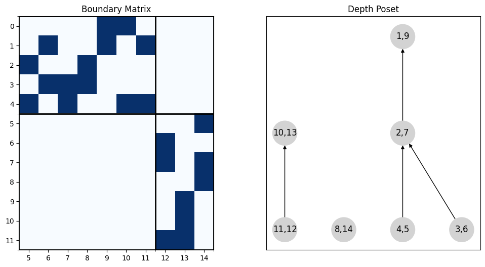
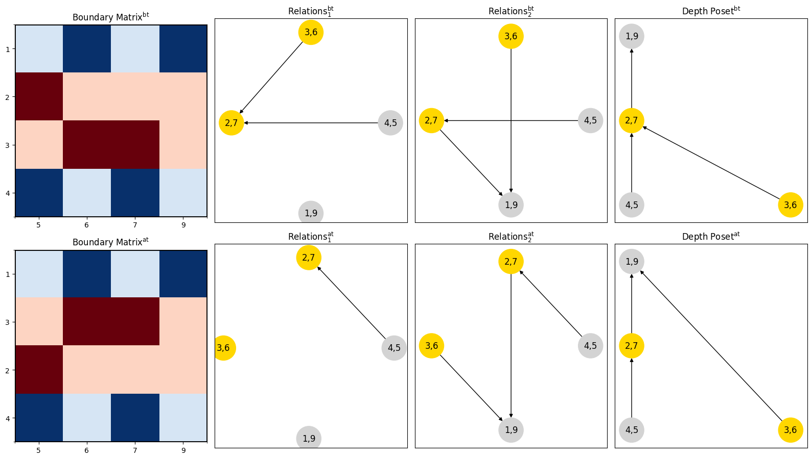
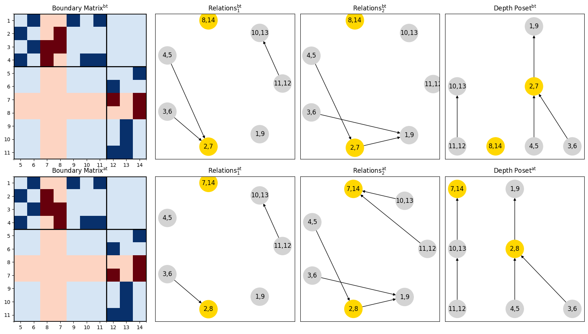
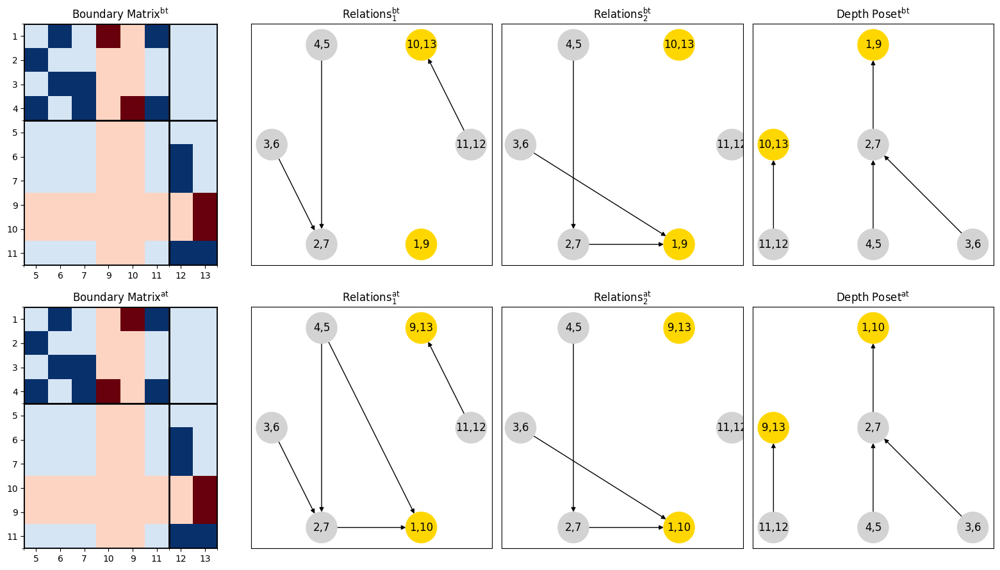

# Data 
We have 1 complex.

## Complex 0
The complex dimendion 2 with 15 cells:

|   Dimension |   Number of Cells |   Betti Number |
|------------:|------------------:|---------------:|
|           0 |                 5 |              1 |
|           1 |                 7 |              0 |
|           2 |                 3 |              0 |

Its Depth Poset has 7 nodes.

# Transpositions
In this data we got 11 by transposing consecutive pairs. The distribution of the transposition types is given in the table:

| transposition_type   |   no switch (nested) |   no switch (not nested) |   switch forward |
|:---------------------|---------------------:|-------------------------:|-----------------:|
| birth-birth          |                    2 |                        1 |                1 |
| birth-death          |                    0 |                        1 |                2 |
| death-death          |                    0 |                        2 |                2 |

# Equations Detailed
We checked 40 equations. And we can see the distribution of transposiions, satysfying these equations in the tables:

## Birth-Birth Transpositions
| Name      | Transposition Type   | Switch Type            | Order           | Formula                                                                                                                                   | Correct (WC)   | Correct (WOC)   | Correct, % (WC)   | Correct, % (WOC)   |
|:----------|:---------------------|:-----------------------|:----------------|:------------------------------------------------------------------------------------------------------------------------------------------|:---------------|:----------------|:------------------|:-------------------|
| Eq08      | birth-birth          | switch forward         | $a < x < y < b$ | $\text{Succ}_1^\text{at}(a, y) = \text{Succ}_1^\text{bt}(x, y) \oplus \{(x, b)\} \oplus \text{Succ}_1^\text{bt}(a, b)$                    | 1/1            | 1/1             | 100.00%           | 100.00%            |
| Eq09      | birth-birth          | switch forward         | $a < x < y < b$ | $\text{Succ}_1^\text{at}(x, b) = \text{Succ}_1^\text{bt}(a, b)$                                                                           | 1/1            | 1/1             | 100.00%           | 100.00%            |
| Eq10      | birth-birth          | switch forward         | $a < x < y < b$ | $\text{Pred}_1^\text{at}(a, y) = \text{Pred}_1^\text{bt}(x, y)$                                                                           | 1/1            | 1/1             | 100.00%           | 100.00%            |
| Eq11      | birth-birth          | switch forward         | $a < x < y < b$ | $\text{Pred}_1^\text{at}(x, b) = \text{Pred}_1^\text{bt}(a, b) \oplus \{(a, y)\}$                                                         | 1/1            | 1/1             | 100.00%           | 100.00%            |
| Eq12      | birth-birth          | switch forward         | $a < x < y < b$ | $\text{Succ}_2^\text{at}(a, y) = \text{Succ}_2^\text{bt}(x, y) \oplus \{(x, b), (a, b)\}$                                                 | 1/1            | 1/1             | 100.00%           | 100.00%            |
| Eq13      | birth-birth          | switch forward         | $a < x < y < b$ | $\text{Succ}_2^\text{at}(x, b) = \text{Succ}_2^\text{bt}(a, b)$                                                                           | 1/1            | 1/1             | 100.00%           | 100.00%            |
| Eq14      | birth-birth          | switch forward         | $a < x < y < b$ | $\text{Pred}_2^\text{at}(a, y) = [\text{Pred}_2^\text{bt}(a, b) \cap \mathcal{L}]$                                                        | 1/1            | 1/1             | 100.00%           | 100.00%            |
| Eq15      | birth-birth          | switch forward         | $a < x < y < b$ | $\text{Pred}_2^\text{at}(x, b) = \text{Pred}_2^\text{bt}(x, y) \oplus \{(a, y)\} \oplus [\text{Pred}_2^\text{bt}(a, b) \cap \mathcal{M}]$ | 1/1            | 1/1             | 100.00%           | 100.00%            |
| Eq16      | birth-birth          | no switch (nested)     | $a < x < y < b$ | $\text{Succ}_1^\text{at}(x, y) = \text{Succ}_1^\text{bt}(x, y) \oplus \{(a, b)\} \oplus \text{Succ}_1^\text{bt}(a, b)$                    | 2/2            | 2/2             | 100.00%           | 100.00%            |
| Eq16s     | birth-birth          | no switch (nested)     | $a < x < y < b$ | $\text{Succ}_1^\text{at}(a, b) = \text{Succ}_1^\text{bt}(a, b) \oplus \{(x, y)\} \oplus \text{Succ}_1^\text{bt}(x, y)$                    | 0/2            | 0/2             | 0.00%             | 0.00%              |
| Eq17      | birth-birth          | no switch (nested)     | $a < x < y < b$ | $\text{Pred}_1^\text{at}(a, b) = \text{Pred}_1^\text{bt}(a, b) \oplus \{(x, y)\}$                                                         | 2/2            | 2/2             | 100.00%           | 100.00%            |
| Eq17s     | birth-birth          | no switch (nested)     | $a < x < y < b$ | $\text{Pred}_1^\text{at}(x, y) = \text{Pred}_1^\text{bt}(x, y) \oplus \{(a, b)\}$                                                         | 0/2            | 0/2             | 0.00%             | 0.00%              |
| EqPred1ab | birth-birth          | no switch (not nested) | $a < x < y < b$ | $\text{Pred}_1^\text{at}(a, b) = \text{Pred}_1^\text{bt}(a, b)$                                                                           | 1/1            | 1/1             | 100.00%           | 100.00%            |
| EqPred1xy | birth-birth          | no switch (not nested) | $a < x < y < b$ | $\text{Pred}_1^\text{at}(x, y) = \text{Pred}_1^\text{bt}(x, y)$                                                                           | 1/1            | 1/1             | 100.00%           | 100.00%            |
| EqPred2ab | birth-birth          | no switch (not nested) | $a < x < y < b$ | $\text{Pred}_2^\text{at}(a, b) = \text{Pred}_2^\text{bt}(a, b)$                                                                           | 1/1            | 1/1             | 100.00%           | 100.00%            |
| EqPred2xy | birth-birth          | no switch (not nested) | $a < x < y < b$ | $\text{Pred}_2^\text{at}(x, y) = \text{Pred}_2^\text{bt}(x, y)$                                                                           | 1/1            | 1/1             | 100.00%           | 100.00%            |
| EqSucc1ab | birth-birth          | no switch (not nested) | $a < x < y < b$ | $\text{Succ}_1^\text{at}(a, b) = \text{Succ}_1^\text{bt}(a, b)$                                                                           | 1/1            | 1/1             | 100.00%           | 100.00%            |
| EqSucc1xy | birth-birth          | no switch (not nested) | $a < x < y < b$ | $\text{Succ}_1^\text{at}(x, y) = \text{Succ}_1^\text{bt}(x, y)$                                                                           | 1/1            | 1/1             | 100.00%           | 100.00%            |
| EqSucc2ab | birth-birth          | no switch (not nested) | $a < x < y < b$ | $\text{Succ}_2^\text{at}(a, b) = \text{Succ}_2^\text{bt}(a, b)$                                                                           | 1/1            | 1/1             | 100.00%           | 100.00%            |
| EqSucc2xy | birth-birth          | no switch (not nested) | $a < x < y < b$ | $\text{Succ}_2^\text{at}(x, y) = \text{Succ}_2^\text{bt}(x, y)$                                                                           | 1/1            | 1/1             | 100.00%           | 100.00%            |

## Death-Death Transpositions
| Name      | Transposition Type   | Switch Type            | Order           | Formula                                                                                                                                  | Correct (WC)   | Correct (WOC)   | Correct, % (WC)   | Correct, % (WOC)   |
|:----------|:---------------------|:-----------------------|:----------------|:-----------------------------------------------------------------------------------------------------------------------------------------|:---------------|:----------------|:------------------|:-------------------|
| Eq28      | death-death          | switch forward         | $a < x < y < b$ | $\text{Succ}_1^\text{at}(x, b) = \text{Succ}_1^\text{bt}(x, y) \oplus \{(a, y), (a, b)\}$                                                | 2/2            | 2/2             | 100.00%           | 100.00%            |
| Eq29      | death-death          | switch forward         | $a < x < y < b$ | $\text{Succ}_1^\text{at}(a, y) = \text{Succ}_1^\text{bt}(a, b)$                                                                          | 2/2            | 2/2             | 100.00%           | 100.00%            |
| Eq30      | death-death          | switch forward         | $a < x < y < b$ | $\text{Pred}_1^\text{at}(x, b) = [\text{Pred}_1^\text{bt}(a, b) \cap \mathcal{B}]$                                                       | 2/2            | 2/2             | 100.00%           | 100.00%            |
| Eq31      | death-death          | switch forward         | $a < x < y < b$ | $\text{Pred}_1^\text{at}(a, y) = \text{Pred}_1^\text{bt}(x, y) \oplus \{(x, b)\} \oplus[\text{Pred}_1^\text{bt}(a, b) \cap \mathcal{N}]$ | 2/2            | 2/2             | 100.00%           | 100.00%            |
| Eq32      | death-death          | switch forward         | $a < x < y < b$ | $\text{Succ}_2^\text{at}(x, b) = \text{Succ}_2^\text{bt}(x, y) \oplus \{(a, y)\} \oplus \text{Succ}_2^\text{bt}(a, b)$                   | 2/2            | 2/2             | 100.00%           | 100.00%            |
| Eq33      | death-death          | switch forward         | $a < x < y < b$ | $\text{Succ}_2^\text{at}(a, y) = \text{Succ}_2^\text{bt}(a, b)$                                                                          | 2/2            | 2/2             | 100.00%           | 100.00%            |
| Eq34      | death-death          | switch forward         | $a < x < y < b$ | $\text{Pred}_2^\text{at}(x, b) = \text{Pred}_2^\text{bt}(x, y)$                                                                          | 2/2            | 2/2             | 100.00%           | 100.00%            |
| Eq35      | death-death          | switch forward         | $a < x < y < b$ | $\text{Pred}_2^\text{at}(a, y) = \text{Pred}_2^\text{bt}(a, b) \oplus \{(x, b)\}$                                                        | 2/2            | 2/2             | 100.00%           | 100.00%            |
| EqPred1ab | death-death          | no switch (not nested) | $a < x < y < b$ | $\text{Pred}_1^\text{at}(a, b) = \text{Pred}_1^\text{bt}(a, b)$                                                                          | 2/2            | 2/2             | 100.00%           | 100.00%            |
| EqPred1xy | death-death          | no switch (not nested) | $a < x < y < b$ | $\text{Pred}_1^\text{at}(x, y) = \text{Pred}_1^\text{bt}(x, y)$                                                                          | 2/2            | 2/2             | 100.00%           | 100.00%            |
| EqPred2ab | death-death          | no switch (not nested) | $a < x < y < b$ | $\text{Pred}_2^\text{at}(a, b) = \text{Pred}_2^\text{bt}(a, b)$                                                                          | 2/2            | 2/2             | 100.00%           | 100.00%            |
| EqPred2xy | death-death          | no switch (not nested) | $a < x < y < b$ | $\text{Pred}_2^\text{at}(x, y) = \text{Pred}_2^\text{bt}(x, y)$                                                                          | 2/2            | 2/2             | 100.00%           | 100.00%            |
| EqSucc1ab | death-death          | no switch (not nested) | $a < x < y < b$ | $\text{Succ}_1^\text{at}(a, b) = \text{Succ}_1^\text{bt}(a, b)$                                                                          | 2/2            | 2/2             | 100.00%           | 100.00%            |
| EqSucc1xy | death-death          | no switch (not nested) | $a < x < y < b$ | $\text{Succ}_1^\text{at}(x, y) = \text{Succ}_1^\text{bt}(x, y)$                                                                          | 2/2            | 2/2             | 100.00%           | 100.00%            |
| EqSucc2ab | death-death          | no switch (not nested) | $a < x < y < b$ | $\text{Succ}_2^\text{at}(a, b) = \text{Succ}_2^\text{bt}(a, b)$                                                                          | 2/2            | 2/2             | 100.00%           | 100.00%            |
| EqSucc2xy | death-death          | no switch (not nested) | $a < x < y < b$ | $\text{Succ}_2^\text{at}(x, y) = \text{Succ}_2^\text{bt}(x, y)$                                                                          | 2/2            | 2/2             | 100.00%           | 100.00%            |

## Birth-Death Transpositions
| Name      | Transposition Type   | Switch Type            | Order           | Formula                                                                              | Correct (WC)   | Correct (WOC)   | Correct, % (WC)   | Correct, % (WOC)   |
|:----------|:---------------------|:-----------------------|:----------------|:-------------------------------------------------------------------------------------|:---------------|:----------------|:------------------|:-------------------|
| Eq48      | birth-death          | switch forward         | $a < b < x < y$ | $\text{Succ}_1^\text{at}(a, x) = \text{Succ}_1^\text{bt}(a, b)$                      | 2/2            | 2/2             | 100.00%           | 100.00%            |
| Eq49      | birth-death          | switch forward         | $a < b < x < y$ | $\text{Succ}_1^\text{at}(b, y) = \text{Succ}_1^\text{bt}(x, y)$                      | 2/2            | 2/2             | 100.00%           | 100.00%            |
| Eq50      | birth-death          | switch forward         | $a < b < x < y$ | $\text{Pred}_1^\text{at}(a, x) = \{(s, t)\in \text{BD}:\; U_1^\text{bt}[t, x] = 1\}$ | 0/2            | 0/2             | 0.00%             | 0.00%              |
| Eq50a     | birth-death          | switch forward         | $a < b < x < y$ | $\text{Pred}_1^\text{at}(a, x) = A_1^\text{bt} \cap B_1^\text{bt}$                   | 0/2            | 2/2             | 0.00%             | 100.00%            |
| Eq50b     | birth-death          | switch forward         | $a < b < x < y$ | $\text{Pred}_1^\text{at}(a, x) = A_1^\text{bt} \cap B_1^\text{at}$                   | 2/2            | 2/2             | 100.00%           | 100.00%            |
| Eq51      | birth-death          | switch forward         | $a < b < x < y$ | $\text{Pred}_1^\text{at}(b, y) = \text{Pred}_1^\text{bt}(x, y)$                      | 2/2            | 2/2             | 100.00%           | 100.00%            |
| Eq52      | birth-death          | switch forward         | $a < b < x < y$ | $\text{Succ}_2^\text{at}(a, x) = \text{Succ}_2^\text{bt}(a, b)$                      | 2/2            | 2/2             | 100.00%           | 100.00%            |
| Eq53      | birth-death          | switch forward         | $a < b < x < y$ | $\text{Succ}_2^\text{at}(b, y) = \text{Succ}_2^\text{bt}(x, y)$                      | 2/2            | 2/2             | 100.00%           | 100.00%            |
| Eq54      | birth-death          | switch forward         | $a < b < x < y$ | $\text{Pred}_2^\text{at}(a, x) = \text{Pred}_2^\text{bt}(a, b)$                      | 2/2            | 2/2             | 100.00%           | 100.00%            |
| Eq55      | birth-death          | switch forward         | $a < b < x < y$ | $\text{Pred}_2^\text{at}(b, y) = \{(s, t)\in \text{BD}:\; U_2^\text{bt}[b, s] = 1\}$ | 1/2            | 1/2             | 50.00%            | 50.00%             |
| Eq55a     | birth-death          | switch forward         | $a < b < x < y$ | $\text{Pred}_2^\text{at}(b, y) = A_2^\text{bt} \cap B_2^\text{bt}$                   | 1/2            | 2/2             | 50.00%            | 100.00%            |
| Eq55b     | birth-death          | switch forward         | $a < b < x < y$ | $\text{Pred}_2^\text{at}(b, y) = A_2^\text{bt} \cap B_2^\text{at}$                   | 2/2            | 2/2             | 100.00%           | 100.00%            |
| EqPred1ab | birth-death          | no switch (not nested) | $a < x < b < y$ | $\text{Pred}_1^\text{at}(a, b) = \text{Pred}_1^\text{bt}(a, b)$                      | 1/1            | 1/1             | 100.00%           | 100.00%            |
| EqPred1xy | birth-death          | no switch (not nested) | $a < x < b < y$ | $\text{Pred}_1^\text{at}(x, y) = \text{Pred}_1^\text{bt}(x, y)$                      | 1/1            | 1/1             | 100.00%           | 100.00%            |
| EqPred2ab | birth-death          | no switch (not nested) | $a < x < b < y$ | $\text{Pred}_2^\text{at}(a, b) = \text{Pred}_2^\text{bt}(a, b)$                      | 1/1            | 1/1             | 100.00%           | 100.00%            |
| EqPred2xy | birth-death          | no switch (not nested) | $a < x < b < y$ | $\text{Pred}_2^\text{at}(x, y) = \text{Pred}_2^\text{bt}(x, y)$                      | 1/1            | 1/1             | 100.00%           | 100.00%            |
| EqSucc1ab | birth-death          | no switch (not nested) | $a < x < b < y$ | $\text{Succ}_1^\text{at}(a, b) = \text{Succ}_1^\text{bt}(a, b)$                      | 1/1            | 1/1             | 100.00%           | 100.00%            |
| EqSucc1xy | birth-death          | no switch (not nested) | $a < x < b < y$ | $\text{Succ}_1^\text{at}(x, y) = \text{Succ}_1^\text{bt}(x, y)$                      | 1/1            | 1/1             | 100.00%           | 100.00%            |
| EqSucc2ab | birth-death          | no switch (not nested) | $a < x < b < y$ | $\text{Succ}_2^\text{at}(a, b) = \text{Succ}_2^\text{bt}(a, b)$                      | 1/1            | 1/1             | 100.00%           | 100.00%            |
| EqSucc2xy | birth-death          | no switch (not nested) | $a < x < b < y$ | $\text{Succ}_2^\text{at}(x, y) = \text{Succ}_2^\text{bt}(x, y)$                      | 1/1            | 1/1             | 100.00%           | 100.00%            |

## Equations Correctness Variants 
The Equations Eq08, Eq09, Eq10, Eq11, Eq12, Eq13, Eq14, Eq15 corespond the __birth-birth switch forward case__.
The correctness distribution for such cases is given in the table:
| Eq08   | Eq09   | Eq10   | Eq11   | Eq12   | Eq13   | Eq14   | Eq15   |   count (WC) |   count (WOC) | portion, % (WC)   | portion, % (WOC)   |
|:-------|:-------|:-------|:-------|:-------|:-------|:-------|:-------|-------------:|--------------:|:------------------|:-------------------|
| ✔      | ✔      | ✔      | ✔      | ✔      | ✔      | ✔      | ✔      |            1 |             1 | 100.00%           | 100.00%            |

The Equations Eq16, Eq16s, Eq17, Eq17s corespond the __birth-birth no switch nested case__.
The correctness distribution for such cases is given in the table:
| Eq16   | Eq16s   | Eq17   | Eq17s   |   count (WC) |   count (WOC) | portion, % (WC)   | portion, % (WOC)   |
|:-------|:--------|:-------|:--------|-------------:|--------------:|:------------------|:-------------------|
| ✔      | ✘       | ✔      | ✘       |            2 |             2 | 100.00%           | 100.00%            |

The Equations Eq28, Eq29, Eq30, Eq31, Eq32, Eq33, Eq34, Eq35 corespond the __death-death switch forward case__.
The correctness distribution for such cases is given in the table:
| Eq28   | Eq29   | Eq30   | Eq31   | Eq32   | Eq33   | Eq34   | Eq35   |   count (WC) |   count (WOC) | portion, % (WC)   | portion, % (WOC)   |
|:-------|:-------|:-------|:-------|:-------|:-------|:-------|:-------|-------------:|--------------:|:------------------|:-------------------|
| ✔      | ✔      | ✔      | ✔      | ✔      | ✔      | ✔      | ✔      |            2 |             2 | 100.00%           | 100.00%            |

The Equations Eq48, Eq49, Eq50, Eq50a, Eq50b, Eq51, Eq52, Eq53, Eq54, Eq55, Eq55a, Eq55b corespond the __birth-death switch forward case__.
The correctness distribution for such cases is given in the table:
| Eq48   | Eq49   | Eq50   | Eq50a   | Eq50b   | Eq51   | Eq52   | Eq53   | Eq54   | Eq55   | Eq55a   | Eq55b   |   count (WC) |   count (WOC) | portion, % (WC)   | portion, % (WOC)   |
|:-------|:-------|:-------|:--------|:--------|:-------|:-------|:-------|:-------|:-------|:--------|:--------|-------------:|--------------:|:------------------|:-------------------|
| ✔      | ✔      | ✘      | ✘       | ✔       | ✔      | ✔      | ✔      | ✔      | ✘      | ✘       | ✔       |            1 |               | 50.00%            |                    |
| ✔      | ✔      | ✘      | ✘       | ✔       | ✔      | ✔      | ✔      | ✔      | ✔      | ✔       | ✔       |            1 |               | 50.00%            |                    |
| ✔      | ✔      | ✘      | ✔       | ✔       | ✔      | ✔      | ✔      | ✔      | ✘      | ✔       | ✔       |              |             1 |                   | 50.00%             |
| ✔      | ✔      | ✘      | ✔       | ✔       | ✔      | ✔      | ✔      | ✔      | ✔      | ✔       | ✔       |              |             1 |                   | 50.00%             |

The Equations EqPred1ab, EqPred1xy, EqPred2ab, EqPred2xy, EqSucc1ab, EqSucc1xy, EqSucc2ab, EqSucc2xy corespond the __birth-birth no switch not nested, death-death no switch not nested, birth-death no switch nested and birth-death no switch not nested cases__.
The correctness distribution for such cases is given in the table:
| EqPred1ab   | EqPred1xy   | EqPred2ab   | EqPred2xy   | EqSucc1ab   | EqSucc1xy   | EqSucc2ab   | EqSucc2xy   |   count (WC) |   count (WOC) | portion, % (WC)   | portion, % (WOC)   |
|:------------|:------------|:------------|:------------|:------------|:------------|:------------|:------------|-------------:|--------------:|:------------------|:-------------------|
| ✔           | ✔           | ✔           | ✔           | ✔           | ✔           | ✔           | ✔           |            4 |             4 | 100.00%           | 100.00%            |

# Incorrect Equations
We have 4 transpositions, such that some equations are incorrect.
We will list some examples.

## Transposition <2, 3> in complex 0
Here is a __birth-birth__ __no switch__ transposition <2, 3>.

$$
a = 2, \; b = 7, \; x = 3, \; y = 6
$$

$$
a < x < y < b
$$

### Birth Death Pairs
|                          |                                      |
|:-------------------------|:-------------------------------------|
| Before the transposition | $\{(4, 5), (1, 9), (2, 7), (3, 6)\}$ |
| After the transposition  | $\{(4, 5), (1, 9), (2, 7), (3, 6)\}$ |

### Relations
|                                | Algorithm 1          | Algorithm 2                  |
|:-------------------------------|:---------------------|:-----------------------------|
| Before the transposition (WC)  | $\{(6, 7), (5, 7)\}$ | $\{(3, 1), (2, 1), (4, 2)\}$ |
| Before the transposition (WOC) | $\{(6, 7), (5, 7)\}$ | $\{(3, 1), (2, 1), (4, 2)\}$ |
| After the transposition (WC)   | $\{(5, 7)\}$         | $\{(3, 1), (2, 1), (4, 2)\}$ |
| After the transposition (WOC)  | $\{(5, 7)\}$         | $\{(3, 1), (2, 1), (4, 2)\}$ |

### Successors and Predecessers
|                       | $\text{Set}^\text{bt}(2, 7)$                         | $\text{Set}^\text{bt}(3, 6)$                 | $\text{Set}^\text{at}(2, 7)$                 | $\text{Set}^\text{at}(3, 6)$                 |
|:----------------------|:-----------------------------------------------------|:---------------------------------------------|:---------------------------------------------|:---------------------------------------------|
| $\text{Succ}_1$ (WC)  | $\text{Succ}_1^\text{bt}(2, 7) = \emptyset$          | $\text{Succ}_1^\text{bt}(3, 6) = \{(2, 7)\}$ | $\text{Succ}_1^\text{at}(2, 7) = \emptyset$  | $\text{Succ}_1^\text{at}(3, 6) = \emptyset$  |
| $\text{Succ}_1$ (WOC) | $\text{Succ}_1^\text{bt}(2, 7) = \emptyset$          | $\text{Succ}_1^\text{bt}(3, 6) = \{(2, 7)\}$ | $\text{Succ}_1^\text{at}(2, 7) = \emptyset$  | $\text{Succ}_1^\text{at}(3, 6) = \emptyset$  |
| $\text{Pred}_1$ (WC)  | $\text{Pred}_1^\text{bt}(2, 7) = \{(4, 5), (3, 6)\}$ | $\text{Pred}_1^\text{bt}(3, 6) = \emptyset$  | $\text{Pred}_1^\text{at}(2, 7) = \{(4, 5)\}$ | $\text{Pred}_1^\text{at}(3, 6) = \emptyset$  |
| $\text{Pred}_1$ (WOC) | $\text{Pred}_1^\text{bt}(2, 7) = \{(4, 5), (3, 6)\}$ | $\text{Pred}_1^\text{bt}(3, 6) = \emptyset$  | $\text{Pred}_1^\text{at}(2, 7) = \{(4, 5)\}$ | $\text{Pred}_1^\text{at}(3, 6) = \emptyset$  |
| $\text{Succ}_2$ (WC)  | $\text{Succ}_2^\text{bt}(2, 7) = \{(1, 9)\}$         | $\text{Succ}_2^\text{bt}(3, 6) = \{(1, 9)\}$ | $\text{Succ}_2^\text{at}(2, 7) = \{(1, 9)\}$ | $\text{Succ}_2^\text{at}(3, 6) = \{(1, 9)\}$ |
| $\text{Succ}_2$ (WOC) | $\text{Succ}_2^\text{bt}(2, 7) = \{(1, 9)\}$         | $\text{Succ}_2^\text{bt}(3, 6) = \{(1, 9)\}$ | $\text{Succ}_2^\text{at}(2, 7) = \{(1, 9)\}$ | $\text{Succ}_2^\text{at}(3, 6) = \{(1, 9)\}$ |
| $\text{Pred}_2$ (WC)  | $\text{Pred}_2^\text{bt}(2, 7) = \{(4, 5)\}$         | $\text{Pred}_2^\text{bt}(3, 6) = \emptyset$  | $\text{Pred}_2^\text{at}(2, 7) = \{(4, 5)\}$ | $\text{Pred}_2^\text{at}(3, 6) = \emptyset$  |
| $\text{Pred}_2$ (WOC) | $\text{Pred}_2^\text{bt}(2, 7) = \{(4, 5)\}$         | $\text{Pred}_2^\text{bt}(3, 6) = \emptyset$  | $\text{Pred}_2^\text{at}(2, 7) = \{(4, 5)\}$ | $\text{Pred}_2^\text{at}(3, 6) = \emptyset$  |

### Temp Sets
|                                                                     | Before the Transposition   | After the Transposition   |
|:--------------------------------------------------------------------|:---------------------------|:--------------------------|
| $\mathcal{L} = \{(s, t)\in \text{BD}:\; f(t) < f(y)\}$ (WC)         | $\{(4, 5)\}$               | $\{(4, 5)\}$              |
| $\mathcal{L} = \{(s, t)\in \text{BD}:\; f(t) < f(y)\}$ (WOC)        | $\{(4, 5)\}$               | $\{(4, 5)\}$              |
| $\mathcal{M} = \{(s, t)\in \text{BD}:\; f(y) < f(t) < f(b)\}$ (WC)  | $\emptyset$                | $\emptyset$               |
| $\mathcal{M} = \{(s, t)\in \text{BD}:\; f(y) < f(t) < f(b)\}$ (WOC) | $\emptyset$                | $\emptyset$               |

### Equations
There are 2 equations are wrong.

| eq    | left (formula)                  | left (paramatrized)             | left (value) (WC)   | left (value) (WOC)   | right (formula)                                                                        | right (paramatrized)                                                                   | right (value) (WC)   | right (value) (WOC)   | correct (WC)   | correct (WOC)   |
|:------|:--------------------------------|:--------------------------------|:--------------------|:---------------------|:---------------------------------------------------------------------------------------|:---------------------------------------------------------------------------------------|:---------------------|:----------------------|:---------------|:----------------|
| Eq16  | $\text{Succ}_1^\text{at}(x, y)$ | $\text{Succ}_1^\text{at}(3, 6)$ | $\emptyset$         | $\emptyset$          | $\text{Succ}_1^\text{bt}(x, y) \oplus \{(a, b)\} \oplus \text{Succ}_1^\text{bt}(a, b)$ | $\text{Succ}_1^\text{bt}(3, 6) \oplus \{(2, 7)\} \oplus \text{Succ}_1^\text{bt}(2, 7)$ | $\emptyset$          | $\emptyset$           | ✔              | ✔               |
| Eq16s | $\text{Succ}_1^\text{at}(a, b)$ | $\text{Succ}_1^\text{at}(2, 7)$ | $\emptyset$         | $\emptyset$          | $\text{Succ}_1^\text{bt}(a, b) \oplus \{(x, y)\} \oplus \text{Succ}_1^\text{bt}(x, y)$ | $\text{Succ}_1^\text{bt}(2, 7) \oplus \{(3, 6)\} \oplus \text{Succ}_1^\text{bt}(3, 6)$ | $\{(2, 7), (3, 6)\}$ | $\{(2, 7), (3, 6)\}$  | ✘              | ✘               |
| Eq17  | $\text{Pred}_1^\text{at}(a, b)$ | $\text{Pred}_1^\text{at}(2, 7)$ | $\{(4, 5)\}$        | $\{(4, 5)\}$         | $\text{Pred}_1^\text{bt}(a, b) \oplus \{(x, y)\}$                                      | $\text{Pred}_1^\text{bt}(2, 7) \oplus \{(3, 6)\}$                                      | $\{(4, 5)\}$         | $\{(4, 5)\}$          | ✔              | ✔               |
| Eq17s | $\text{Pred}_1^\text{at}(x, y)$ | $\text{Pred}_1^\text{at}(3, 6)$ | $\emptyset$         | $\emptyset$          | $\text{Pred}_1^\text{bt}(x, y) \oplus \{(a, b)\}$                                      | $\text{Pred}_1^\text{bt}(3, 6) \oplus \{(2, 7)\}$                                      | $\{(2, 7)\}$         | $\{(2, 7)\}$          | ✘              | ✘               |

## Transposition <7, 8> in complex 0
Here is a __birth-death__ __switch forward__ transposition <7, 8>.

$$
a = 2, \; b = 7, \; x = 8, \; y = 14
$$

$$
a < b < x < y
$$

### Birth Death Pairs
|                          |                                                                   |
|:-------------------------|:------------------------------------------------------------------|
| Before the transposition | $\{(8, 14), (2, 7), (10, 13), (11, 12), (4, 5), (3, 6), (1, 9)\}$ |
| After the transposition  | $\{(2, 8), (10, 13), (11, 12), (4, 5), (3, 6), (1, 9), (7, 14)\}$ |

### Relations
|                                | Algorithm 1                                                                                 | Algorithm 2                                                                               |
|:-------------------------------|:--------------------------------------------------------------------------------------------|:------------------------------------------------------------------------------------------|
| Before the transposition (WC)  | $\{(6, 7), (12, 13), (5, 7)\}$                                                              | $\{(3, 1), (2, 1), (4, 2)\}$                                                              |
| Before the transposition (WOC) | $\{(9, 10), (5, 11), (7, 10), (6, 8), (12, 13), (5, 7), (6, 7), (5, 10), (7, 11), (7, 8)\}$ | $\{(11, 7), (2, 1), (3, 1), (8, 7), (10, 7), (4, 2), (11, 6), (10, 6), (10, 9), (8, 5)\}$ |
| After the transposition (WC)   | $\{(6, 8), (12, 13)\}$                                                                      | $\{(11, 7), (2, 1), (3, 1), (10, 7), (4, 2)\}$                                            |
| After the transposition (WOC)  | $\{(9, 10), (5, 11), (8, 7), (6, 8), (12, 13), (8, 10), (5, 7), (6, 7), (5, 10), (8, 11)\}$ | $\{(11, 7), (2, 1), (3, 1), (10, 7), (4, 2), (11, 6), (10, 6), (10, 9), (7, 5), (7, 8)\}$ |

### Successors and Predecessers
|                       | $\text{Set}^\text{bt}(2, 7)$                         | $\text{Set}^\text{bt}(8, 14)$                | $\text{Set}^\text{at}(2, 8)$                 | $\text{Set}^\text{at}(7, 14)$                             |
|:----------------------|:-----------------------------------------------------|:---------------------------------------------|:---------------------------------------------|:----------------------------------------------------------|
| $\text{Succ}_1$ (WC)  | $\text{Succ}_1^\text{bt}(2, 7) = \emptyset$          | $\text{Succ}_1^\text{bt}(8, 14) = \emptyset$ | $\text{Succ}_1^\text{at}(2, 8) = \emptyset$  | $\text{Succ}_1^\text{at}(7, 14) = \emptyset$              |
| $\text{Succ}_1$ (WOC) | $\text{Succ}_1^\text{bt}(2, 7) = \emptyset$          | $\text{Succ}_1^\text{bt}(8, 14) = \emptyset$ | $\text{Succ}_1^\text{at}(2, 8) = \emptyset$  | $\text{Succ}_1^\text{at}(7, 14) = \emptyset$              |
| $\text{Pred}_1$ (WC)  | $\text{Pred}_1^\text{bt}(2, 7) = \{(4, 5), (3, 6)\}$ | $\text{Pred}_1^\text{bt}(8, 14) = \emptyset$ | $\text{Pred}_1^\text{at}(2, 8) = \{(3, 6)\}$ | $\text{Pred}_1^\text{at}(7, 14) = \emptyset$              |
| $\text{Pred}_1$ (WOC) | $\text{Pred}_1^\text{bt}(2, 7) = \{(4, 5), (3, 6)\}$ | $\text{Pred}_1^\text{bt}(8, 14) = \emptyset$ | $\text{Pred}_1^\text{at}(2, 8) = \{(3, 6)\}$ | $\text{Pred}_1^\text{at}(7, 14) = \emptyset$              |
| $\text{Succ}_2$ (WC)  | $\text{Succ}_2^\text{bt}(2, 7) = \{(1, 9)\}$         | $\text{Succ}_2^\text{bt}(8, 14) = \emptyset$ | $\text{Succ}_2^\text{at}(2, 8) = \{(1, 9)\}$ | $\text{Succ}_2^\text{at}(7, 14) = \emptyset$              |
| $\text{Succ}_2$ (WOC) | $\text{Succ}_2^\text{bt}(2, 7) = \{(1, 9)\}$         | $\text{Succ}_2^\text{bt}(8, 14) = \emptyset$ | $\text{Succ}_2^\text{at}(2, 8) = \{(1, 9)\}$ | $\text{Succ}_2^\text{at}(7, 14) = \emptyset$              |
| $\text{Pred}_2$ (WC)  | $\text{Pred}_2^\text{bt}(2, 7) = \{(4, 5)\}$         | $\text{Pred}_2^\text{bt}(8, 14) = \emptyset$ | $\text{Pred}_2^\text{at}(2, 8) = \{(4, 5)\}$ | $\text{Pred}_2^\text{at}(7, 14) = \{(11, 12), (10, 13)\}$ |
| $\text{Pred}_2$ (WOC) | $\text{Pred}_2^\text{bt}(2, 7) = \{(4, 5)\}$         | $\text{Pred}_2^\text{bt}(8, 14) = \emptyset$ | $\text{Pred}_2^\text{at}(2, 8) = \{(4, 5)\}$ | $\text{Pred}_2^\text{at}(7, 14) = \{(11, 12), (10, 13)\}$ |

### Temp Sets
|                                                                    | Before the Transposition          | After the Transposition   |
|:-------------------------------------------------------------------|:----------------------------------|:--------------------------|
| $A_1 = \{(s, t)\in \text{BD}:\; f(a) < f(s) < f(t) < f(x)\}$ (WC)  | $\{(4, 5), (3, 6)\}$              | $\{(4, 5), (3, 6)\}$      |
| $A_1 = \{(s, t)\in \text{BD}:\; f(a) < f(s) < f(t) < f(x)\}$ (WOC) | $\{(4, 5), (3, 6)\}$              | $\{(4, 5), (3, 6)\}$      |
| $B_1 = \{(s, t)\in \text{BD}:\; U_1[t, x] = 1\}$ (WC)              | $\emptyset$                       | $\{(3, 6)\}$              |
| $B_1 = \{(s, t)\in \text{BD}:\; U_1[t, x] = 1\}$ (WOC)             | $\{(2, 7), (3, 6)\}$              | $\{(3, 6)\}$              |
| $A_2 = \{(s, t)\in \text{BD}:\; f(b) < f(s) < f(t) < f(y)\}$ (WC)  | $\{(11, 12), (10, 13)\}$          | $\{(11, 12), (10, 13)\}$  |
| $A_2 = \{(s, t)\in \text{BD}:\; f(b) < f(s) < f(t) < f(y)\}$ (WOC) | $\{(11, 12), (10, 13)\}$          | $\{(11, 12), (10, 13)\}$  |
| $B_2 = \{(s, t)\in \text{BD}:\; U_2[b, s] = 1\}$ (WC)              | $\emptyset$                       | $\{(11, 12), (10, 13)\}$  |
| $B_2 = \{(s, t)\in \text{BD}:\; U_2[b, s] = 1\}$ (WOC)             | $\{(11, 12), (8, 14), (10, 13)\}$ | $\{(11, 12), (10, 13)\}$  |

### Equations
There are 4 equations are wrong.

| eq    | left (formula)                  | left (paramatrized)              | left (value) (WC)        | left (value) (WOC)       | right (formula)                                      | right (paramatrized)                                 | right (value) (WC)       | right (value) (WOC)      | correct (WC)   | correct (WOC)   |
|:------|:--------------------------------|:---------------------------------|:-------------------------|:-------------------------|:-----------------------------------------------------|:-----------------------------------------------------|:-------------------------|:-------------------------|:---------------|:----------------|
| Eq48  | $\text{Succ}_1^\text{at}(a, x)$ | $\text{Succ}_1^\text{at}(2, 8)$  | $\emptyset$              | $\emptyset$              | $\text{Succ}_1^\text{bt}(a, b)$                      | $\text{Succ}_1^\text{bt}(2, 7)$                      | $\emptyset$              | $\emptyset$              | ✔              | ✔               |
| Eq49  | $\text{Succ}_1^\text{at}(b, y)$ | $\text{Succ}_1^\text{at}(7, 14)$ | $\emptyset$              | $\emptyset$              | $\text{Succ}_1^\text{bt}(x, y)$                      | $\text{Succ}_1^\text{bt}(8, 14)$                     | $\emptyset$              | $\emptyset$              | ✔              | ✔               |
| Eq50  | $\text{Pred}_1^\text{at}(a, x)$ | $\text{Pred}_1^\text{at}(2, 8)$  | $\{(3, 6)\}$             | $\{(3, 6)\}$             | $\{(s, t)\in \text{BD}:\; U_1^\text{bt}[t, x] = 1\}$ | $\{(s, t)\in \text{BD}:\; U_1^\text{bt}[t, 8] = 1\}$ | $\emptyset$              | $\emptyset$              | ✘              | ✘               |
| Eq50a | $\text{Pred}_1^\text{at}(a, x)$ | $\text{Pred}_1^\text{at}(2, 8)$  | $\{(3, 6)\}$             | $\{(3, 6)\}$             | $A_1^\text{bt} \cap B_1^\text{bt}$                   | $A_1^\text{bt} \cap B_1^\text{bt}$                   | $\emptyset$              | $\{(3, 6)\}$             | ✘              | ✔               |
| Eq50b | $\text{Pred}_1^\text{at}(a, x)$ | $\text{Pred}_1^\text{at}(2, 8)$  | $\{(3, 6)\}$             | $\{(3, 6)\}$             | $A_1^\text{bt} \cap B_1^\text{at}$                   | $A_1^\text{bt} \cap B_1^\text{at}$                   | $\{(3, 6)\}$             | $\{(3, 6)\}$             | ✔              | ✔               |
| Eq51  | $\text{Pred}_1^\text{at}(b, y)$ | $\text{Pred}_1^\text{at}(7, 14)$ | $\emptyset$              | $\emptyset$              | $\text{Pred}_1^\text{bt}(x, y)$                      | $\text{Pred}_1^\text{bt}(8, 14)$                     | $\emptyset$              | $\emptyset$              | ✔              | ✔               |
| Eq52  | $\text{Succ}_2^\text{at}(a, x)$ | $\text{Succ}_2^\text{at}(2, 8)$  | $\{(1, 9)\}$             | $\{(1, 9)\}$             | $\text{Succ}_2^\text{bt}(a, b)$                      | $\text{Succ}_2^\text{bt}(2, 7)$                      | $\{(1, 9)\}$             | $\{(1, 9)\}$             | ✔              | ✔               |
| Eq53  | $\text{Succ}_2^\text{at}(b, y)$ | $\text{Succ}_2^\text{at}(7, 14)$ | $\emptyset$              | $\emptyset$              | $\text{Succ}_2^\text{bt}(x, y)$                      | $\text{Succ}_2^\text{bt}(8, 14)$                     | $\emptyset$              | $\emptyset$              | ✔              | ✔               |
| Eq54  | $\text{Pred}_2^\text{at}(a, x)$ | $\text{Pred}_2^\text{at}(2, 8)$  | $\{(4, 5)\}$             | $\{(4, 5)\}$             | $\text{Pred}_2^\text{bt}(a, b)$                      | $\text{Pred}_2^\text{bt}(2, 7)$                      | $\{(4, 5)\}$             | $\{(4, 5)\}$             | ✔              | ✔               |
| Eq55  | $\text{Pred}_2^\text{at}(b, y)$ | $\text{Pred}_2^\text{at}(7, 14)$ | $\{(11, 12), (10, 13)\}$ | $\{(11, 12), (10, 13)\}$ | $\{(s, t)\in \text{BD}:\; U_2^\text{bt}[b, s] = 1\}$ | $\{(s, t)\in \text{BD}:\; U_2^\text{bt}[7, s] = 1\}$ | $\emptyset$              | $\emptyset$              | ✘              | ✘               |
| Eq55a | $\text{Pred}_2^\text{at}(b, y)$ | $\text{Pred}_2^\text{at}(7, 14)$ | $\{(11, 12), (10, 13)\}$ | $\{(11, 12), (10, 13)\}$ | $A_2^\text{bt} \cap B_2^\text{bt}$                   | $A_2^\text{bt} \cap B_2^\text{bt}$                   | $\emptyset$              | $\{(11, 12), (10, 13)\}$ | ✘              | ✔               |
| Eq55b | $\text{Pred}_2^\text{at}(b, y)$ | $\text{Pred}_2^\text{at}(7, 14)$ | $\{(11, 12), (10, 13)\}$ | $\{(11, 12), (10, 13)\}$ | $A_2^\text{bt} \cap B_2^\text{at}$                   | $A_2^\text{bt} \cap B_2^\text{at}$                   | $\{(11, 12), (10, 13)\}$ | $\{(11, 12), (10, 13)\}$ | ✔              | ✔               |

## Transposition <9, 10> in complex 0
Here is a __birth-death__ __switch forward__ transposition <9, 10>.

$$
a = 1, \; b = 9, \; x = 10, \; y = 13
$$

$$
a < b < x < y
$$

### Birth Death Pairs
|                          |                                                          |
|:-------------------------|:---------------------------------------------------------|
| Before the transposition | $\{(2, 7), (10, 13), (11, 12), (4, 5), (3, 6), (1, 9)\}$ |
| After the transposition  | $\{(9, 13), (2, 7), (11, 12), (4, 5), (1, 10), (3, 6)\}$ |

### Relations
|                                | Algorithm 1                                                                 | Algorithm 2                                                               |
|:-------------------------------|:----------------------------------------------------------------------------|:--------------------------------------------------------------------------|
| Before the transposition (WC)  | $\{(6, 7), (12, 13), (5, 7)\}$                                              | $\{(3, 1), (2, 1), (4, 2)\}$                                              |
| Before the transposition (WOC) | $\{(9, 10), (5, 11), (7, 10), (12, 13), (5, 7), (6, 7), (5, 10), (7, 11)\}$ | $\{(11, 7), (2, 1), (3, 1), (10, 7), (4, 2), (11, 6), (10, 6), (10, 9)\}$ |
| After the transposition (WC)   | $\{(7, 10), (12, 13), (5, 7), (6, 7), (5, 10)\}$                            | $\{(3, 1), (2, 1), (4, 2)\}$                                              |
| After the transposition (WOC)  | $\{(5, 11), (7, 10), (12, 13), (5, 7), (6, 7), (5, 10), (10, 9), (7, 11)\}$ | $\{(9, 10), (11, 7), (2, 1), (3, 1), (9, 6), (4, 2), (11, 6), (9, 7)\}$   |

### Successors and Predecessers
|                       | $\text{Set}^\text{bt}(1, 9)$                         | $\text{Set}^\text{bt}(10, 13)$                   | $\text{Set}^\text{at}(1, 10)$                         | $\text{Set}^\text{at}(9, 13)$                   |
|:----------------------|:-----------------------------------------------------|:-------------------------------------------------|:------------------------------------------------------|:------------------------------------------------|
| $\text{Succ}_1$ (WC)  | $\text{Succ}_1^\text{bt}(1, 9) = \emptyset$          | $\text{Succ}_1^\text{bt}(10, 13) = \emptyset$    | $\text{Succ}_1^\text{at}(1, 10) = \emptyset$          | $\text{Succ}_1^\text{at}(9, 13) = \emptyset$    |
| $\text{Succ}_1$ (WOC) | $\text{Succ}_1^\text{bt}(1, 9) = \emptyset$          | $\text{Succ}_1^\text{bt}(10, 13) = \emptyset$    | $\text{Succ}_1^\text{at}(1, 10) = \emptyset$          | $\text{Succ}_1^\text{at}(9, 13) = \emptyset$    |
| $\text{Pred}_1$ (WC)  | $\text{Pred}_1^\text{bt}(1, 9) = \emptyset$          | $\text{Pred}_1^\text{bt}(10, 13) = \{(11, 12)\}$ | $\text{Pred}_1^\text{at}(1, 10) = \{(4, 5), (2, 7)\}$ | $\text{Pred}_1^\text{at}(9, 13) = \{(11, 12)\}$ |
| $\text{Pred}_1$ (WOC) | $\text{Pred}_1^\text{bt}(1, 9) = \emptyset$          | $\text{Pred}_1^\text{bt}(10, 13) = \{(11, 12)\}$ | $\text{Pred}_1^\text{at}(1, 10) = \{(4, 5), (2, 7)\}$ | $\text{Pred}_1^\text{at}(9, 13) = \{(11, 12)\}$ |
| $\text{Succ}_2$ (WC)  | $\text{Succ}_2^\text{bt}(1, 9) = \emptyset$          | $\text{Succ}_2^\text{bt}(10, 13) = \emptyset$    | $\text{Succ}_2^\text{at}(1, 10) = \emptyset$          | $\text{Succ}_2^\text{at}(9, 13) = \emptyset$    |
| $\text{Succ}_2$ (WOC) | $\text{Succ}_2^\text{bt}(1, 9) = \emptyset$          | $\text{Succ}_2^\text{bt}(10, 13) = \emptyset$    | $\text{Succ}_2^\text{at}(1, 10) = \emptyset$          | $\text{Succ}_2^\text{at}(9, 13) = \emptyset$    |
| $\text{Pred}_2$ (WC)  | $\text{Pred}_2^\text{bt}(1, 9) = \{(2, 7), (3, 6)\}$ | $\text{Pred}_2^\text{bt}(10, 13) = \emptyset$    | $\text{Pred}_2^\text{at}(1, 10) = \{(2, 7), (3, 6)\}$ | $\text{Pred}_2^\text{at}(9, 13) = \emptyset$    |
| $\text{Pred}_2$ (WOC) | $\text{Pred}_2^\text{bt}(1, 9) = \{(2, 7), (3, 6)\}$ | $\text{Pred}_2^\text{bt}(10, 13) = \emptyset$    | $\text{Pred}_2^\text{at}(1, 10) = \{(2, 7), (3, 6)\}$ | $\text{Pred}_2^\text{at}(9, 13) = \emptyset$    |

### Temp Sets
|                                                                    | Before the Transposition     | After the Transposition      |
|:-------------------------------------------------------------------|:-----------------------------|:-----------------------------|
| $A_1 = \{(s, t)\in \text{BD}:\; f(a) < f(s) < f(t) < f(x)\}$ (WC)  | $\{(4, 5), (2, 7), (3, 6)\}$ | $\{(4, 5), (2, 7), (3, 6)\}$ |
| $A_1 = \{(s, t)\in \text{BD}:\; f(a) < f(s) < f(t) < f(x)\}$ (WOC) | $\{(4, 5), (2, 7), (3, 6)\}$ | $\{(4, 5), (2, 7), (3, 6)\}$ |
| $B_1 = \{(s, t)\in \text{BD}:\; U_1[t, x] = 1\}$ (WC)              | $\emptyset$                  | $\{(4, 5), (2, 7)\}$         |
| $B_1 = \{(s, t)\in \text{BD}:\; U_1[t, x] = 1\}$ (WOC)             | $\{(4, 5), (1, 9), (2, 7)\}$ | $\{(4, 5), (2, 7)\}$         |
| $A_2 = \{(s, t)\in \text{BD}:\; f(b) < f(s) < f(t) < f(y)\}$ (WC)  | $\{(11, 12)\}$               | $\{(11, 12)\}$               |
| $A_2 = \{(s, t)\in \text{BD}:\; f(b) < f(s) < f(t) < f(y)\}$ (WOC) | $\{(11, 12)\}$               | $\{(11, 12)\}$               |
| $B_2 = \{(s, t)\in \text{BD}:\; U_2[b, s] = 1\}$ (WC)              | $\emptyset$                  | $\emptyset$                  |
| $B_2 = \{(s, t)\in \text{BD}:\; U_2[b, s] = 1\}$ (WOC)             | $\{(10, 13)\}$               | $\emptyset$                  |

### Equations
There are 2 equations are wrong.

| eq    | left (formula)                  | left (paramatrized)              | left (value) (WC)    | left (value) (WOC)   | right (formula)                                      | right (paramatrized)                                  | right (value) (WC)   | right (value) (WOC)   | correct (WC)   | correct (WOC)   |
|:------|:--------------------------------|:---------------------------------|:---------------------|:---------------------|:-----------------------------------------------------|:------------------------------------------------------|:---------------------|:----------------------|:---------------|:----------------|
| Eq48  | $\text{Succ}_1^\text{at}(a, x)$ | $\text{Succ}_1^\text{at}(1, 10)$ | $\emptyset$          | $\emptyset$          | $\text{Succ}_1^\text{bt}(a, b)$                      | $\text{Succ}_1^\text{bt}(1, 9)$                       | $\emptyset$          | $\emptyset$           | ✔              | ✔               |
| Eq49  | $\text{Succ}_1^\text{at}(b, y)$ | $\text{Succ}_1^\text{at}(9, 13)$ | $\emptyset$          | $\emptyset$          | $\text{Succ}_1^\text{bt}(x, y)$                      | $\text{Succ}_1^\text{bt}(10, 13)$                     | $\emptyset$          | $\emptyset$           | ✔              | ✔               |
| Eq50  | $\text{Pred}_1^\text{at}(a, x)$ | $\text{Pred}_1^\text{at}(1, 10)$ | $\{(4, 5), (2, 7)\}$ | $\{(4, 5), (2, 7)\}$ | $\{(s, t)\in \text{BD}:\; U_1^\text{bt}[t, x] = 1\}$ | $\{(s, t)\in \text{BD}:\; U_1^\text{bt}[t, 10] = 1\}$ | $\emptyset$          | $\emptyset$           | ✘              | ✘               |
| Eq50a | $\text{Pred}_1^\text{at}(a, x)$ | $\text{Pred}_1^\text{at}(1, 10)$ | $\{(4, 5), (2, 7)\}$ | $\{(4, 5), (2, 7)\}$ | $A_1^\text{bt} \cap B_1^\text{bt}$                   | $A_1^\text{bt} \cap B_1^\text{bt}$                    | $\emptyset$          | $\{(4, 5), (2, 7)\}$  | ✘              | ✔               |
| Eq50b | $\text{Pred}_1^\text{at}(a, x)$ | $\text{Pred}_1^\text{at}(1, 10)$ | $\{(4, 5), (2, 7)\}$ | $\{(4, 5), (2, 7)\}$ | $A_1^\text{bt} \cap B_1^\text{at}$                   | $A_1^\text{bt} \cap B_1^\text{at}$                    | $\{(4, 5), (2, 7)\}$ | $\{(4, 5), (2, 7)\}$  | ✔              | ✔               |
| Eq51  | $\text{Pred}_1^\text{at}(b, y)$ | $\text{Pred}_1^\text{at}(9, 13)$ | $\{(11, 12)\}$       | $\{(11, 12)\}$       | $\text{Pred}_1^\text{bt}(x, y)$                      | $\text{Pred}_1^\text{bt}(10, 13)$                     | $\{(11, 12)\}$       | $\{(11, 12)\}$        | ✔              | ✔               |
| Eq52  | $\text{Succ}_2^\text{at}(a, x)$ | $\text{Succ}_2^\text{at}(1, 10)$ | $\emptyset$          | $\emptyset$          | $\text{Succ}_2^\text{bt}(a, b)$                      | $\text{Succ}_2^\text{bt}(1, 9)$                       | $\emptyset$          | $\emptyset$           | ✔              | ✔               |
| Eq53  | $\text{Succ}_2^\text{at}(b, y)$ | $\text{Succ}_2^\text{at}(9, 13)$ | $\emptyset$          | $\emptyset$          | $\text{Succ}_2^\text{bt}(x, y)$                      | $\text{Succ}_2^\text{bt}(10, 13)$                     | $\emptyset$          | $\emptyset$           | ✔              | ✔               |
| Eq54  | $\text{Pred}_2^\text{at}(a, x)$ | $\text{Pred}_2^\text{at}(1, 10)$ | $\{(2, 7), (3, 6)\}$ | $\{(2, 7), (3, 6)\}$ | $\text{Pred}_2^\text{bt}(a, b)$                      | $\text{Pred}_2^\text{bt}(1, 9)$                       | $\{(2, 7), (3, 6)\}$ | $\{(2, 7), (3, 6)\}$  | ✔              | ✔               |
| Eq55  | $\text{Pred}_2^\text{at}(b, y)$ | $\text{Pred}_2^\text{at}(9, 13)$ | $\emptyset$          | $\emptyset$          | $\{(s, t)\in \text{BD}:\; U_2^\text{bt}[b, s] = 1\}$ | $\{(s, t)\in \text{BD}:\; U_2^\text{bt}[9, s] = 1\}$  | $\emptyset$          | $\{(4, 5)\}$          | ✔              | ✘               |
| Eq55a | $\text{Pred}_2^\text{at}(b, y)$ | $\text{Pred}_2^\text{at}(9, 13)$ | $\emptyset$          | $\emptyset$          | $A_2^\text{bt} \cap B_2^\text{bt}$                   | $A_2^\text{bt} \cap B_2^\text{bt}$                    | $\emptyset$          | $\emptyset$           | ✔              | ✔               |
| Eq55b | $\text{Pred}_2^\text{at}(b, y)$ | $\text{Pred}_2^\text{at}(9, 13)$ | $\emptyset$          | $\emptyset$          | $A_2^\text{bt} \cap B_2^\text{at}$                   | $A_2^\text{bt} \cap B_2^\text{at}$                    | $\emptyset$          | $\emptyset$           | ✔              | ✔               |